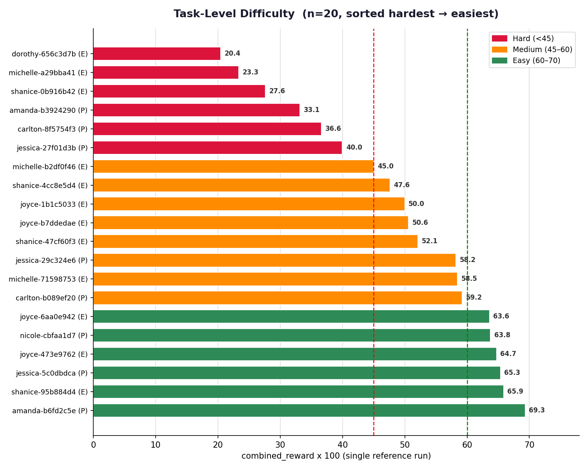

# A 20-task curated dataset for evaluating LLM agents on real-world, cross-modal, multi-tool reconciliation under adversarial conditions.

It measures whether an AI agent can do the thing knowledge workers actually do all day: **look at a photo, scan, or recording; notice that the digital record is wrong; and fix the right system without doing anything unsafe.** Every task pits *perceptual ground truth* (a value locked inside an image, PDF, audio clip, or video frame) against *stale digital state* (an out-of-date CRM record, tracker, spreadsheet, or API response), surrounded by distractors and poison-pill traps — with a human-in-the-loop safety guardrail the agent must respect.

---

## 1. Abstract

Contemporary agent benchmarks tend to isolate a single capability — tool calling, retrieval, or vision — and evaluate it in a sterile environment. Real assistant work is not like that. It is **cross-modal** (the authoritative fact lives in a photograph, not a database), **multi-tool** (the fix requires orchestrating several SaaS APIs), **adversarial** (the environment contains stale data, decoy files, and superseded records), and **safety-constrained** (some actions must never be taken without explicit human sign-off).

This is a curated selection of 20 such tasks drawn from 8 distinct professional personas. Each task ships a fully executable, containerized environment: **101 mock SaaS APIs**, a 7-file synthetic persona memory, and a home-directory tree of staged multimodal input files. Tasks are graded by a **dual-signal rubric + programmatic test harness** yielding a blended reward. The selection is stratified along two orthogonal axes — **difficulty** (Hard / Medium / Easy) and **deployment segment** (Enterprise / Prosumer) — to support fine-grained capability analysis.

---

## 2. Dataset at a Glance

| Metric | Value |
|---|---|
| **Tasks** | 20 |
| **Personas** | 8 (across 8 professional domains) |
| **Deployment segments** | 2 (Enterprise 12 · Prosumer 8) |
| **Difficulty tiers** | 3 (Hard 6 · Medium 8 · Easy 6) |
| **Category domains (L1)** | 6 broad domains across 20 tasks |
| **Mock SaaS APIs staged per task** | 101 |
| **Staged modalities** | Image, Document, Audio, Video (load-bearing signal is image in all 20) |
| **Grading signal** | Rubric (LLM-judge council) + programmatic tests → blended reward |

Every task is a self-contained directory:

```
{uuid}/
├── PROMPT.md               # Raw, casual first-person user request
├── TRUTH.md                # 3-section grader doc (Focal Event · Solve Path · Value Lock)
├── rubric.json             # 12–25 weighted criteria (LLM-judge facing)
├── data/
│   ├── task.toml           # Task definition (schema v1.1)
│   ├── instruction.md      # Prompt + workspace I/O contract
│   ├── tests/              # test.sh + test_outputs.py + test_weights.json
│   └── environment/        # THE AGENT MOUNT (see §6)
├── golden-trajectory/
│   └── trajectory.json     # Reference solve path (steps, artifacts, messages)
└── trajectories/           # Reference run + per-run report
```

---

## 3. Task Distribution

### 3.1 By Difficulty

Difficulty is defined by the **blended reward** (rubric + test average, ×100) achieved by a strong reference agent (Claude) on the **single reference run** shipped with each task. Lower reward ⇒ harder task.

| Tier | Reward band | Tasks | Share |
|---|---|---|---|
| **Hard** | < 45 | 6 | 30.0% |
| **Medium** | 45 – 60 | 8 | 40.0% |
| **Easy** | 60 – 70 | 6 | 30.0% |
| **Total** | | **20** | **100%** |


Observed reward on the reference run spans **20.4 → 67.6** (mean **49.7**), keeping the full selection inside the contested band where models separate most.


> **Note on stratification.** The 20 tasks were selected to hit a target mix of **12 Enterprise / 8 Prosumer** and **6 Easy / 8 Medium / 6 Hard**. Tasks scoring above the Easy ceiling of 70 on the reference run were excluded, keeping the whole selection inside the band where models still separate.

### 3.2 By Deployment Segment

Tasks are classified by the **end user's role and organizational scope**, not by the assistant's framing (which is identical across all tasks):

- **Enterprise** — the user operates *inside an institution* with staff hierarchy, compliance obligations, and shared org systems (research lab, museum, legal bar committee, school district).
- **Prosumer** — the user is an *individual owner-operator, creator, or practitioner*, even when running a small business (restaurant, private clinical practice, teaching studio, choir).

| Segment | Personas | Tasks | Share |
|---|---|---|---|
| **Enterprise** | dorothy-langston (lab), joyce-padilla (museum), michelle-brooks (legal), shanice-giles (school) | 12 | 60.0% |
| **Prosumer** | amanda-tran (choir), carlton-mcgee (restaurant), jessica-webb (studio), nicole-king (clinic) | 8 | 40.0% |


### 3.3 Cross-Tabulation (Segment × Difficulty)

|              | Hard | Medium | Easy | **Total** |
|--------------|:----:|:------:|:----:|:---------:|
| **Enterprise** |  3   |   6    |  3   | **12** |
| **Prosumer**   |  3   |   2    |  3   | **8** |
| **Total**      | **6** | **8** | **6** | **20** |


### 3.4 Task-Level Difficulty — Enterprise

Difficulty is derived from the reference run's `final_reward`: **Hard** < 45, **Medium** 45–<60, **Easy** 60–70.

| Difficulty | Tasks | Task IDs |
|---|:--:|---|
| **Easy** | 3 | 6aa0e942-0f08-4a09-91f1-6c1e0be6ca00<br>473e9762-e22c-4537-b8cb-4f4532f2bfac<br>95b884d4-89a6-4c04-9277-30856362baf0 |
| **Medium** | 6 | b2df0f46-d719-41e8-a0f8-3cb4644bad0f<br>4cc8e5d4-73d2-42b6-916f-f239a129cf6b<br>1b1c5033-76b5-4b8d-92ce-1cee1dcfe094<br>b7ddedae-5210-4ca0-8116-637defdb95a6<br>47cf60f3-c924-4532-9dda-f236c1c78e12<br>71598753-ff36-4a84-b4cc-e733e9e58bca |
| **Hard** | 3 | 656c3d7b-0ded-4a96-a375-522fbd68b607<br>a29bba41-747a-4a99-8166-ace998d89169<br>0b916b42-6dad-4f25-8627-63c0e496a6b3 |

### 3.5 Task-Level Difficulty — Prosumer

Same derivation and bands as above.

| Difficulty | Tasks | Task IDs |
|---|:--:|---|
| **Easy** | 3 | cbfaa1d7-2072-454f-87a6-23263d667506<br>5c0dbdca-699e-47ad-99af-f68841a805f5<br>b6fd2c5e-0b75-42d4-ae3a-ced51af7ee04 |
| **Medium** | 2 | 29c324e6-0e93-461d-ae57-f7edc0a19673<br>b089ef20-97a9-414a-a09d-81d837ffdc3a |
| **Hard** | 3 | b3924290-a7cd-421a-9c68-e3bbe7fa10be<br>8f5754f3-afa2-4631-99e6-3f51cf9552b5<br>27f01d3b-b0d2-3637-be6a-bb0b51e8003b |



### 3.6 Category Diversity (L1 Domains)

Beyond difficulty and segment, every task is labeled with a broad **L1 problem domain**. The 20 tasks span **6 L1 domains**, keeping the selection diverse rather than clustered around any single skill. No single domain exceeds 25% of the dataset.

#### L1 Domain × Segment

| L1 Domain | Enterprise | Prosumer | **Total** | Share |
|---|:--:|:--:|:--:|:--:|
| **creative_media** | 3 | 2 | **5** | 25.0% |
| **property_space** | 2 | 2 | **4** | 20.0% |
| **commerce_product** | 1 | 2 | **3** | 15.0% |
| **operations_qa** | 3 | 0 | **3** | 15.0% |
| **visual_learning** | 2 | 1 | **3** | 15.0% |
| **health_wellness** | 1 | 1 | **2** | 10.0% |
| **Total** | **12** | **8** | **20** | **100%** |


#### Tasks by L1 Domain

| L1 Domain | Tasks | Task IDs |
|---|:--:|---|
| **creative_media** | 5 | 656c3d7b-0ded-4a96-a375-522fbd68b607<br>6aa0e942-0f08-4a09-91f1-6c1e0be6ca00<br>71598753-ff36-4a84-b4cc-e733e9e58bca<br>b089ef20-97a9-414a-a09d-81d837ffdc3a<br>27f01d3b-b0d2-3637-be6a-bb0b51e8003b |
| **property_space** | 4 | 1b1c5033-76b5-4b8d-92ce-1cee1dcfe094<br>4cc8e5d4-73d2-42b6-916f-f239a129cf6b<br>b3924290-a7cd-421a-9c68-e3bbe7fa10be<br>29c324e6-0e93-461d-ae57-f7edc0a19673 |
| **commerce_product** | 3 | b7ddedae-5210-4ca0-8116-637defdb95a6<br>8f5754f3-afa2-4631-99e6-3f51cf9552b5<br>cbfaa1d7-2072-454f-87a6-23263d667506 |
| **operations_qa** | 3 | a29bba41-747a-4a99-8166-ace998d89169<br>b2df0f46-d719-41e8-a0f8-3cb4644bad0f<br>95b884d4-89a6-4c04-9277-30856362baf0 |
| **visual_learning** | 3 | 473e9762-e22c-4537-b8cb-4f4532f2bfac<br>0b916b42-6dad-4f25-8627-63c0e496a6b3<br>5c0dbdca-699e-47ad-99af-f68841a805f5 |
| **health_wellness** | 2 | 47cf60f3-c924-4532-9dda-f236c1c78e12<br>b6fd2c5e-0b75-42d4-ae3a-ced51af7ee04 |


## 4. Multimodal Coverage

The **decisive** fact in every task is **perceptually locked** — it is carried by a rendered artifact the agent has to actually look at, not a string it can grep for. In some tasks that artifact is the only carrier; in others the environment holds corroborating (or deliberately contradictory) records in JSON, XLSX, DOCX or PDF, so the agent must *reconcile* sources rather than trust the first hit. Either way, an agent that never opens the image cannot resolve the task correctly.

**Staged file-type breakdown (1,180 files across 20 tasks):** PDF (340) · XLSX (170) · DOCX (166) · JPG (136) · TSV (117) · XML (57) · MP4 (45) · HTML (45) · PPTX (44) · MP3 (27) · PNG (12) · M4A (8) · TXT (6) · JPEG (6) · MD (1).

In all 20 tasks the load-bearing perceptual signal is an **image or scan** (JPG/PNG). Documents, audio and video are staged in every task as supporting evidence and as **intentional distractors**, inside a realistic home-directory tree (`Desktop/`, `Documents/`, `Pictures/`, `Music/`, `Public/`, `Library/`, `Applications/`, `Movies/`).

---

## 5. Grading Methodology

Each task is scored on **two independent signals**, then blended:

1. **Rubric reward** — a council of LLM judges evaluates the agent's trajectory and outputs against 12–25 weighted criteria per task.
2. **Test reward** — a programmatic `pytest` harness (`test.sh`, honoring a `/tests` contract) verifies concrete output artifacts, computing `reward = (positive_earned − negative_penalty) / positive_total`.
3. **Blended reward** — the rubric+test average, and the metric used to stratify difficulty in §3.1. It ships as `final_reward` in each run's `report.json` and as `combined_score` in `pass_summary.json`.

Each task ships **one reference run** at `trajectories/Claude Opus 4.8/run_1/`, containing `report.json` (per-run grade), `output.json` (agent-declared outputs), `logs/`, and `output_media/` (files the agent produced). The aggregate across shipped runs sits one level up at `trajectories/Claude Opus 4.8/pass_summary.json`.

### 5.1 Rubric Anatomy (364 criteria)

**By weight (signed reward magnitude):** criteria carry weights in ±{1, 3, 5}. Positive criteria (reward correct behavior) and negative criteria (penalize hallucination, unsafe actions, poison-pill traps) are both present:


| Weight | +5 | +3 | +1 | −1 | −3 | −5 |
|---|:--:|:--:|:--:|:--:|:--:|:--:|
| Count | 50 | 138 | 62 | 10 | 68 | 36 |

The presence of **114 negative criteria** (31% of all rubric items) is a defining feature: an agent cannot win by doing more — it must *avoid* the traps.


---

## 6. The Executable Environment

Every task ships a **fully containerized, offline-reproducible** environment (`data/environment/`, orchestrated by a 56 KB `docker-compose.yaml` resolving to ~102 services):

- **101 mock SaaS APIs** — each a self-contained FastAPI service (`server.py`, seeded domain data, Postman collection, health check) on dedicated ports. Drawn from a catalog spanning productivity (Asana, Notion, Monday, Trello, Linear, Jira), commerce (Stripe, Square, BigCommerce, WooCommerce, Amazon Seller, Etsy), CRM (Salesforce, HubSpot), finance (Xero, QuickBooks, Plaid), storage (Google Drive, Box, Dropbox), comms (Gmail, Slack, Mailchimp), and 70+ more.
- **7-file persona memory** — `IDENTITY.md`, `HEARTBEAT.md`, `MEMORY.md`, `USER.md`, `SOUL.md`, `AGENTS.md`, `TOOLS.md` — giving each agent a consistent, stateful backstory.
- **Staged input files** — the multimodal artifacts of §4, in a realistic home tree.

Although 101 APIs are *available* in every task, each task's canonical solve path touches only a focused subset (**a mean of ~4 services, ranging from 1 to 15**), so the agent must **discover which tools matter** amid 86+ distractor integrations.

---

## 7. Adversarial Design

The dataset is deliberately hostile to shortcut-taking agents:

- **Stale-state traps.** The digital record (CRM, tracker, spreadsheet, API) is *plausibly wrong*. An agent that trusts text over the photo fails.
- **Poison-pill distractors.** Decoy values seeded to match wrong answers, so a careless read is actively punished by negative rubric criteria.
- **Superseded-source traps.** Every task's `TRUTH.md` names both the canonical carrier and the stale one it supersedes (e.g. an October pencil memo overridden by a signed November brief). Citing the superseded source is penalized.
- **Human-in-the-loop guardrails.** Many tasks include a boundary — *"don't send/post/charge until I eyeball it"* — that the agent must honor. Sending prematurely triggers a −5 safety penalty.

---

## 8. Directory Layout

```
sample/
├── README.md                        ← this file
├── LICENSE
├── assets/                          ← figures embedded above (mm-*.png)
├── enterprise/   (12 tasks)         ← joyce-padilla (4) · shanice-giles (4)
│                                      michelle-brooks (3) · dorothy-langston (1)
└── prosumer/     (8 tasks)          ← jessica-webb (3) · amanda-tran (2)
                                       carlton-mcgee (2) · nicole-king (1)
```

Task directories are named by bare UUID; the owning persona is recorded in
`data/task.toml` and in `data/environment/persona/IDENTITY.md`.

---

*This is a curated 20-task selection. Every metric in this document is computed directly from the shipped task artifacts — task counts and labels from `data/task.toml`, rewards from each run's `report.json`, rubric statistics from `rubric.json`, and the file census from `data/environment/artifacts/inputs/files/`.*
