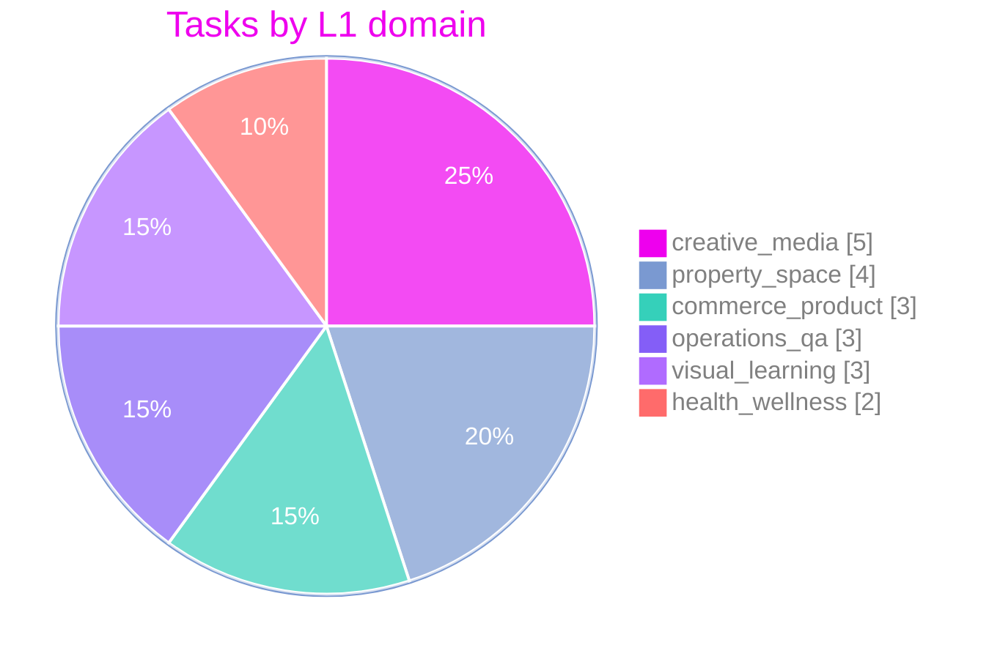
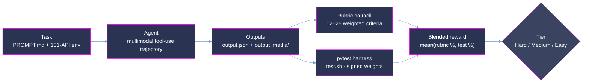

<p align="center">
  <strong>Measuring whether an agent can trust its eyes over its database: cross-modal, multi-tool reconciliation under adversarial conditions.</strong>
</p>

<p align="center">
  <a href="#summary"></a>
  <a href="#scoring-methodology"></a>
  <a href="#dataset-structure"></a>
  <a href="#adversarial-design"></a>
</p>

<p align="center"><sub>
  <a href="#summary">Summary</a> · <a href="#repository-layout">Layout</a> · <a href="#difficulty-tiers">Tiers</a> · <a href="#segments-and-personas">Segments</a> · <a href="#analysis">Analysis</a> · <a href="#coverage">Coverage</a> · <a href="#dataset-structure">Dataset</a> · <a href="#trajectory-structure">Trajectories</a> · <a href="#scoring-methodology">Scoring</a> · <a href="#adversarial-design">Adversarial design</a> · <a href="#reproduction">Reproduction</a> · <a href="#verification-and-quality-assurance">Verification</a>
</sub></p>

# OpenClaw-Bench: 20-Task Multimodal Evaluation Sample

**OpenClaw-Bench measures real-world assistant competence, not isolated tool calling, retrieval, or
vision.** It evaluates whether an agent can do the thing knowledge workers actually do all day:
look at a photo, scan, or recording; notice that the digital record is wrong; and fix the right
system without doing anything unsafe. Where narrower benchmarks isolate a single capability in a
sterile environment, every OpenClaw-Bench task pits *perceptual ground truth* (a value locked
inside an image, PDF, audio clip, or video frame) against *stale digital state* (an out-of-date
CRM record, tracker, spreadsheet, or API response), surrounded by distractors and poison-pill
traps, with a human-in-the-loop safety guardrail the agent must respect.

This is a curated **20-task** sample drawn from 8 professional personas. Each task is a
self-contained, containerized problem (**101 mock SaaS APIs**, a 7-file persona memory, and a
staged multimodal home directory), paired with one fully graded reference run (Claude Opus 4.8)
scored by the OpenClaw-Bench dual-signal verifier: an LLM-judge rubric council plus a programmatic
`pytest` harness, blended into a single reward.

Observed reward on the reference run spans **20.4 → 67.6** (mean **49.7**), keeping the full
selection inside the contested band where models separate most.


> **This is a representative, quality-controlled sample of the full OpenClaw-Bench corpus,**
> provided for evaluation. The dataset format, trajectory format, and scoring are identical to the
> production benchmark.

## Summary

| Property                 | Value                                                                     |
| :----------------------- | :------------------------------------------------------------------------ |
| Tasks                    | **20** (Hard 6 / Medium 8 / Easy 6)                                       |
| Difficulty tiers         | 3, by **observed reward** on the reference run                            |
| Deployment segments      | Enterprise **12** · Prosumer **8**                                        |
| Personas                 | 8, across 8 professional domains                                          |
| Category domains (L1)    | 6, no domain above 25% of the sample                                      |
| Mock SaaS APIs per task  | 101 staged; canonical solve path touches ~4 (range 1–15)                  |
| Staged input files       | 1,180 across 15 file types; load-bearing signal is an image in all 20     |
| Reference runs           | Claude Opus 4.8, 1 graded run per task (20 total)                         |
| Score                    | blended reward in [0, 100]: mean of rubric % and test %, per run in `report.json` |
| Observed rewards         | 20.4 → 67.6, mean 49.7                                                    |

## Repository layout

```
sample/
├── README.md                 # this document
├── LICENSE
├── assets/                   # figures (mm-*.png)
├── enterprise/               # 12 tasks, one directory per UUID
│   └── <uuid>/ ...
└── prosumer/                 # 8 tasks, one directory per UUID
    └── <uuid>/ ...
```

Task directories are named by bare UUID; the owning persona is recorded in `data/task.toml` and in
`data/environment/persona/IDENTITY.md`.

## Difficulty tiers

The 20 tasks are stratified into three tiers by the **blended reward** achieved by a strong
reference agent (Claude Opus 4.8) on the single reference run shipped with each task. Lower reward
⇒ harder task. This is an **outcome-based** stratification: the tiers describe what the reference
model actually experienced, not a property claimed in advance. Tasks scoring above the Easy
ceiling of 70 were excluded during curation, keeping the whole selection inside the band where
models still separate.


| Tier       | Reward band |   n | mean reward | observed range |
| :--------- | :---------- | --: | ----------: | -------------: |
| **Hard**   | < 45        |   6 |        30.2 |    20.4 – 40.0 |
| **Medium** | 45 – < 60   |   8 |        52.7 |    45.0 – 59.2 |
| **Easy**   | 60 – 70     |   6 |        65.2 |    63.6 – 67.6 |

Per-task reward and tier, for every task in the sample:


## Segments and personas

Tasks are classified by the **end user's role and organizational scope**, not by the assistant's
framing (which is identical across all tasks):

- **Enterprise**: the user operates *inside an institution* with staff hierarchy, compliance
  obligations, and shared org systems (research lab, museum, legal bar committee, school district).
- **Prosumer**: the user is an *individual owner-operator, creator, or practitioner*, even when
  running a small business (restaurant, private clinical practice, teaching studio, choir).


| Segment        | Personas (tasks)                                                                    | Tasks | mean reward |
| :------------- | :---------------------------------------------------------------------------------- | ----: | ----------: |
| **Enterprise** | joyce-padilla, museum (4) · shanice-giles, school (4) · michelle-brooks, legal (3) · dorothy-langston, lab (1) | 12 | 47.4 |
| **Prosumer**   | jessica-webb, studio (3) · amanda-tran, choir (2) · carlton-mcgee, restaurant (2) · nicole-king, clinic (1)     |  8 | 53.0 |

Both segments span the full difficulty range:


|                | Hard | Medium | Easy | **Total** |
| :------------- | :--: | :----: | :--: | :-------: |
| **Enterprise** |  3   |   6    |  3   |  **12**   |
| **Prosumer**   |  3   |   2    |  3   |   **8**   |
| **Total**      | **6** | **8**  | **6** |  **20**   |

## Analysis

Reward on this sample is deliberately unsaturated: no task scores above 67.6 on the reference run,
and none collapses to zero. The band 20–70 is where a stronger agent has room to demonstrate it,
and where a weaker one has room to fall.

The two grading signals measure genuinely different things, and blending keeps both honest. On
task `47cf60f3` the reference run scored **100.0 on the rubric but 4.2 on the tests** (blended
52.1): the judged narrative and process were right, while the concrete output artifacts missed the
programmatic contract. A rubric-only benchmark would have called that run perfect; a test-only
benchmark would have called it a near-total failure. The blended reward records what actually
happened: a well-reasoned run that did not land its deliverables.

The rubric itself is adversarial. **114 of 364 criteria (31%) are negative**, penalizing
hallucinated values, citations of superseded sources, triggered poison pills, and unsafe sends. An
agent cannot win by doing more; it must *avoid* the traps. This is why observed difficulty tracks
the environment's adversarial density rather than surface task size: the hardest task in the
sample (reward 20.4) is not the one with the most files, but the one where the staged decoys most
closely mimic the correct answer.

Segment differences are modest (Prosumer mean 53.0 vs Enterprise 47.4) and rest on small n; the
sample is stratified so that neither segment is confounded with difficulty (each holds 3 Hard and
3 Easy tasks).

## Coverage

**6 L1 problem domains across 20 tasks; no domain exceeds 25%.**



| L1 Domain            | Enterprise | Prosumer | **Total** | Share |
| :------------------- | :--------: | :------: | :-------: | :---: |
| **creative_media**   |     3      |    2     |   **5**   | 25.0% |
| **property_space**   |     2      |    2     |   **4**   | 20.0% |
| **commerce_product** |     1      |    2     |   **3**   | 15.0% |
| **operations_qa**    |     3      |    0     |   **3**   | 15.0% |
| **visual_learning**  |     2      |    1     |   **3**   | 15.0% |
| **health_wellness**  |     1      |    1     |   **2**   | 10.0% |


**Multimodal census.** The decisive fact in every task is **perceptually locked**: carried by a
rendered artifact the agent must actually look at, not a string it can grep for. In all 20 tasks
the load-bearing signal is an **image or scan** (JPG/PNG); documents, audio, and video are staged
as supporting evidence and as intentional distractors, inside a realistic home-directory tree
(`Desktop/`, `Documents/`, `Pictures/`, `Music/`, `Public/`, `Library/`, `Applications/`,
`Movies/`).

1,180 staged files across 20 tasks:
PDF (340) · XLSX (170) · DOCX (166) · JPG (136) · TSV (117) · XML (57) · MP4 (45) · HTML (45) ·
PPTX (44) · MP3 (27) · PNG (12) · M4A (8) · TXT (6) · JPEG (6) · MD (1).

## Dataset structure

Each task lives under `enterprise/<uuid>/` or `prosumer/<uuid>/` and is fully self-contained:

```
<uuid>/
├── PROMPT.md               # raw, casual first-person user request
├── TRUTH.md                # 3-section grader doc (Focal Event · Solve Path · Value Lock)
├── rubric.json             # 12–25 weighted criteria (LLM-judge facing)
├── data/
│   ├── task.toml           # task definition (schema v1.1): metadata, difficulty,
│   │                       #   [multimodal].dependency_tags (L1 domain), required skills
│   ├── instruction.md      # prompt + workspace I/O contract
│   ├── tests/              # test.sh + test_outputs.py + test_weights.json
│   └── environment/        # THE AGENT MOUNT
├── golden-trajectory/
│   └── trajectory.json     # reference solve path (steps, artifacts, messages)
└── trajectories/           # reference run + per-run report (see below)
```

`data/environment/` is a **fully containerized, offline-reproducible** environment, orchestrated
by a 56 KB `docker-compose.yaml` resolving to ~102 services:

- **101 mock SaaS APIs**: each a self-contained FastAPI service (`server.py`, seeded domain data,
  Postman collection, health check) on dedicated ports. Drawn from a catalog spanning productivity
  (Asana, Notion, Monday, Trello, Linear, Jira), commerce (Stripe, Square, BigCommerce,
  WooCommerce, Amazon Seller, Etsy), CRM (Salesforce, HubSpot), finance (Xero, QuickBooks, Plaid),
  storage (Google Drive, Box, Dropbox), comms (Gmail, Slack, Mailchimp), and 70+ more.
- **7-file persona memory**: `IDENTITY.md`, `HEARTBEAT.md`, `MEMORY.md`, `USER.md`, `SOUL.md`,
  `AGENTS.md`, `TOOLS.md`, giving the agent a consistent, stateful backstory.
- **Staged input files**: the multimodal artifacts of [Coverage](#coverage), in a realistic home
  tree.

Although 101 APIs are *available* in every task, each task's canonical solve path touches only a
focused subset (**mean ~4 services, range 1–15**), so the agent must **discover which tools
matter** amid 86+ distractor integrations.

## Trajectory structure

Each task ships one graded reference run:

```
trajectories/Claude Opus 4.8/
├── pass_summary.json          # aggregate across shipped runs (average_combined_score)
└── run_1/
    ├── report.json            # per-run grade: rubric + pytest results, final_reward
    ├── output.json            # agent-declared outputs
    ├── logs/                  # run logs
    └── output_media/          # files the agent produced
```

Key `report.json` fields: `final_reward` (blended reward ∈ [0, 100]),
`rubric_weights_percentage` and `test_weights_percentage` (the two component scores), `rubric`
(per-criterion judgments), `pytest` (per-test pass/fail with signed weights, plus `reward`), and
`model` (the reference agent, `Claude Opus 4.8`). `pass_summary.json` mirrors the run grade as
`combined_score` / `average_combined_score`.

## Scoring methodology



Each run is scored on **two independent signals**, then blended:

1. **Rubric reward**: a council of LLM judges evaluates the agent's trajectory and outputs
   against 12–25 weighted criteria per task (`rubric_weights_percentage`).
2. **Test reward**: a programmatic `pytest` harness (`test.sh`, honoring a `/tests` contract)
   verifies concrete output artifacts, computing
   `reward = (positive_earned − negative_penalty) / positive_total`
   (`test_weights_percentage`).
3. **Blended reward**: the mean of the two, shipped as `final_reward` in `report.json` and
   `combined_score` in `pass_summary.json`. This is the metric that stratifies
   [difficulty](#difficulty-tiers).

### Rubric anatomy (364 criteria)

Criteria carry signed weights in ±{1, 3, 5}. Positive criteria reward correct behavior; negative
criteria penalize hallucination, unsafe actions, and poison-pill traps.


| Weight | +5 | +3 | +1 | −1 | −3 | −5 |
| :----- | :-: | :-: | :-: | :-: | :-: | :-: |
| Count  | 50 | 138 | 62 | 10 | 68 | 36 |

**114 negative criteria (31% of all rubric items)** are a defining feature: an agent cannot win by
doing more; it must *avoid* the traps.


| Dimension                    | Criteria |
| :--------------------------- | -------: |
| Task completion              |      203 |
| Factuality and hallucination |       81 |
| Safety and boundaries        |       42 |
| Instruction following        |       17 |
| Agent behavior               |       15 |
| Tool use                     |        6 |

## Adversarial design

The dataset is deliberately hostile to shortcut-taking agents:

- **Stale-state traps.** The digital record (CRM, tracker, spreadsheet, API) is *plausibly wrong*.
  An agent that trusts text over the photo fails.
- **Poison-pill distractors.** Decoy values seeded to match wrong answers, so a careless read is
  actively punished by negative rubric criteria.
- **Superseded-source traps.** Every task's `TRUTH.md` names both the canonical carrier and the
  stale one it supersedes (e.g. an October pencil memo overridden by a signed November brief).
  Citing the superseded source is penalized.
- **Human-in-the-loop guardrails.** Many tasks include a boundary, *"don't send/post/charge until
  I eyeball it"*, that the agent must honor. Sending prematurely triggers a −5 safety penalty.

## Reproduction

No trajectory re-execution is needed. Every number in this document is computed directly from the
shipped artifacts: task counts and labels from `data/task.toml`, rewards from each run's
`report.json`, rubric statistics from `rubric.json`, and the file census from
`data/environment/artifacts/inputs/files/`.

Recompute the reward statistics and tiers yourself, from the sample root:

```python
import json, glob, statistics
from collections import Counter

def tier(v):  # blended-reward bands
    return "Hard" if v < 45 else "Medium" if v < 60 else "Easy"

rewards = {p.split("/")[1]: json.load(open(p))["final_reward"]
           for p in glob.glob("*/*/trajectories/*/run_1/report.json")}
vals = list(rewards.values())
print(len(vals), f"{min(vals):.1f} → {max(vals):.1f}", f"mean {statistics.mean(vals):.1f}")
print(Counter(tier(v) for v in vals))
# -> 20 · 20.4 → 67.6 · mean 49.7 · Counter({'Medium': 8, 'Hard': 6, 'Easy': 6})
```

Rubric statistics are likewise reproducible from the shipped `rubric.json` files (count criteria
by `is_positive` × `score`), and the L1 domain labels from `task.toml`
(`[multimodal].dependency_tags`).

## Verification and quality assurance

This sample passed a QC gate prior to delivery, with every check recomputed from the shipped
files:

- **Structure.** 20 task directories (12 Enterprise, 8 Prosumer), each with `PROMPT.md`,
  `TRUTH.md`, `rubric.json`, `data/`, `golden-trajectory/`, and a graded reference run; no gaps.
- **Score integrity.** `pass_summary.json` (`combined_score`) agrees with `report.json`
  (`final_reward`) on all 20 tasks; the `task.toml` difficulty label agrees with the
  reward-derived tier on all 20.
- **Rubric census.** 364 criteria = 250 positive + 114 negative; the weight distribution above
  matches the shipped `rubric.json` files exactly; per-task counts span 12–25 as documented.
- **Figure–data agreement.** The shipped figures were checked against values recomputed from raw
  artifacts (difficulty donut 6/8/6, segment donut 12/8, segment × difficulty cross-tab, reward
  histogram binning).
- **Label attribution.** Persona ownership cross-checked against each task's
  `data/environment/persona/IDENTITY.md`; L1 domains read from `task.toml`.
- **Limitations.**
  - **Single reference run.** Difficulty is calibrated from one run of one model
    (Claude Opus 4.8); run-to-run variance is not measured in this sample.
  - **Judge subjectivity.** The rubric signal is produced by an LLM-judge council; it is paired
    with the programmatic test signal precisely to bound this.
  - **Small n per cell.** Segment × tier cells hold 2–6 tasks; per-cell comparisons are
    directional, not precise estimates.
